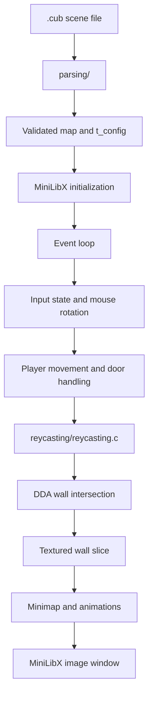

# Cub3D

A small first-person 3D renderer written in C with MiniLibX. Cub3D reads a `.cub` scene description, validates the map and rendering configuration, then projects the 2D grid into a textured 3D view using raycasting and the DDA grid-traversal algorithm.

This repository is an implementation of the Cub3D project from the 42 curriculum. It is intended for developers and students interested in low-level graphics, parsing, event loops, texture mapping, and real-time rendering in C.

> **Repository status:** The project currently has no declared open-source license, CI workflow, Docker configuration, automated test suite, or release metadata. The instructions below are based on the checked-in source and `Makefile`.

## Contents

- [Features](#features)
- [Preview](#preview)
- [Tech stack](#tech-stack)
- [How it works](#how-it-works)
- [Repository structure](#repository-structure)
- [Prerequisites](#prerequisites)
- [Build and run](#build-and-run)
- [Scene file format](#scene-file-format)
- [Controls](#controls)
- [Validation and error handling](#validation-and-error-handling)
- [Testing and code quality](#testing-and-code-quality)
- [Troubleshooting](#troubleshooting)
- [Roadmap](#roadmap)
- [Contributing](#contributing)
- [License](#license)
- [Author](#author)

## Features

- Raycasting renderer with one ray cast per screen column.
- DDA-based wall detection and perpendicular-distance correction.
- Textured north, south, east, and west wall faces.
- Configurable floor and ceiling RGB colors.
- Collision-aware forward, backward, and strafing movement.
- Keyboard and mouse view rotation.
- Doors that can be opened and closed with the space bar.
- In-game minimap with player-direction indicator.
- Two frame-based animations loaded from `textures/animation/` and `textures/surprise/`.
- Map validation for file extension, allowed symbols, player count, map boundaries, spaces, textures, and colors.
- Explicit cleanup paths for maps, textures, MiniLibX resources, and animation data.

## Preview

No screenshot is currently committed to the repository. To add a preview, capture the running window and place the image in a directory such as `docs/images/`, then replace the placeholder below:

```text
<!-- Add a repository image here, for example: docs/images/cub3d-preview.png -->
```

## Tech stack

- **Language:** C
- **Graphics:** MiniLibX (`mlx`)
- **Build system:** Make
- **Input and windowing:** MiniLibX keyboard, mouse, window-close, image, and event-loop APIs
- **Assets:** XPM textures and animation frames
- **Platform configuration:** The active linker flags target macOS; a Linux linker configuration is retained as a commented alternative in `Makefile`.

There is no database, web API, authentication layer, environment-variable configuration, Docker setup, or frontend framework in this repository.

## How it works

At startup, `cub3d.c` accepts one `.cub` file, parses its map and rendering configuration, initializes MiniLibX, loads textures, and starts the event loop. Each frame clears the image, updates movement, casts rays, draws textured wall slices, renders the minimap and animations, and presents the image in the window.



The main runtime pipeline is implemented by `put_content()` in `cub3d.c`. Ray traversal is handled in `reycasting/reycasting.c`, wall projection and texture selection in `reycasting/rendring.c`, movement in `reycasting/player_movments.c`, and MiniLibX resource setup in `reycasting/mlx_tools.c`.

## Repository structure

```text
.
├── cub3d.c                         # Program entry point and frame loop
├── headers/
│   └── cub3d.h                     # Shared constants, structs, and prototypes
├── parsing/                         # .cub loading, map validation, colors, textures
│   ├── parsing.c                    # File loading and map normalization
│   ├── parse_map*.c                 # Map discovery, content, bounds, and player checks
│   ├── parse_texture*.c             # Texture directives and prefix validation
│   ├── parse_color.c                # Floor and ceiling RGB parsing
│   └── flood_fill.c                 # Connectivity and boundary validation
├── reycasting/                      # Runtime rendering and interaction
│   ├── reycasting.c                 # Ray setup, DDA traversal, and ray loop
│   ├── rendring.c                   # Textured wall-column projection
│   ├── player_movments*.c            # Movement, collision, and keyboard state
│   ├── door_functions*.c             # Door interaction and state tracking
│   ├── putting_content.c             # Pixel, minimap, and drawing helpers
│   ├── mlx_tools.c                  # MiniLibX initialization and texture loading
│   ├── mouse.c                      # Mouse rotation and minimap direction marker
│   └── anim*.c, surprise*.c          # Frame-based animations
├── utils/otherFunctions/             # String, memory, conversion, and parsing helpers
│   └── get_next_line/                # Line-oriented file reader
├── maps/                             # Example .cub scene files
├── textures/                         # XPM wall, door, and animation assets
├── Makefile                          # Build and cleanup targets
├── Subject.pdf                       # Original project subject included in the repo
└── README.md                         # Project documentation
```

## Prerequisites

The active `Makefile` is configured for macOS:

- macOS with a working C compiler available as `cc`.
- `make`.
- MiniLibX installed and discoverable by the compiler/linker.
- OpenGL and AppKit framework support, used by the active linker flags.

The Makefile also contains a commented Linux configuration using `minilibx-linux`, `libXext`, `libX11`, `libbsd`, `libm`, and `libGL`. That configuration is not active by default and may require adapting the MiniLibX include/library paths for the target machine.

## Build and run

Clone the repository and build the executable:

```bash
git clone https://github.com/A-chem/42-Cursus-Cub3d.git
cd 42-Cursus-Cub3d
make
```

Run the program with exactly one `.cub` scene file:

```bash
./cub3D maps/map2.cub
```

Other checked-in examples are available in `maps/`:

```bash
./cub3D maps/map.cub
./cub3D maps/map3.cub
```

The executable is named `cub3D`, and the window is created at `1500x1200`, as defined by `WIDTH` and `HEIGHT` in `headers/cub3d.h`.

### Make targets

```bash
make          # Build cub3D
make clean    # Remove object files
make fclean   # Remove object files and cub3D
make re       # Full clean rebuild
```

## Scene file format

The program expects a `.cub` file containing four wall texture directives, floor and ceiling colors, and a map. The parser accepts the following directives:

```text
NO ./textures/north.xpm
SO ./textures/south.xpm
WE ./textures/west.xpm
EA ./textures/east.xpm
F 71,71,71
C 0,0,1
```

The map uses these symbols:

| Symbol | Meaning |
| --- | --- |
| `1` | Wall |
| `0` | Walkable space |
| `N` | Player facing north |
| `S` | Player facing south |
| `E` | Player facing east |
| `W` | Player facing west |
| `D` | Door |
| Space | Padding/empty map space subject to validation |

Example map excerpt:

```text
111111111111111
100000000000001
100000N00000D01
100000000000001
111111111111111
```

The checked-in parser requires exactly one player orientation, at least one wall, walkable space, and door, and rejects unsupported map characters. It also checks that the map is enclosed and that invalid spaces or disconnected areas do not expose the map to the outside.

Texture paths are loaded relative to the process working directory. Run `./cub3D` from the repository root so paths such as `./textures/north.xpm` resolve correctly. The door texture is loaded internally from `./textures/door.xpm`.

## Controls

| Input | Action |
| --- | --- |
| `W` | Move forward |
| `S` | Move backward |
| `A` | Strafe left |
| `D` | Strafe right |
| `Left Arrow` | Rotate left |
| `Right Arrow` | Rotate right |
| `Space` | Open or close a nearby door |
| `F` | Trigger the loaded surprise animation |
| `Esc` | Exit |
| Mouse movement | Rotate the view horizontally |

The key codes in `headers/cub3d.h` are MiniLibX/macOS key codes. Linux MiniLibX environments may report different key codes and could require platform-specific adjustments.

## Validation and error handling

Before creating the rendering window, the parser:

1. Requires a `.cub` extension and readable input file.
2. Normalizes rows to the longest map width.
3. Locates the map section after configuration directives.
4. Validates allowed map characters and counts player, wall, walkable-space, and door cells.
5. Requires exactly one player start orientation.
6. Validates map connectivity and boundaries using flood-fill checks.
7. Requires all `NO`, `SO`, `WE`, and `EA` texture directives.
8. Validates one floor and one ceiling color, each as three integer RGB components in the range `0..255`.
9. Loads the referenced XPM textures and exits with an error if a required asset cannot be loaded.

Errors are reported on standard error and terminate the process; messages include `Map Error`, `Error: Invalid colors`, missing-texture errors, and MiniLibX initialization/loading errors.

## Testing and code quality

No automated tests, lint configuration, formatter configuration, or CI workflow is currently checked in. The project can be validated manually with the existing maps and with intentionally malformed `.cub` files.

Build with the compiler warnings enforced by the Makefile:

```bash
make
```

The active compiler flags are:

```text
-Wall -Wextra -Werror
```

For runtime memory inspection on a compatible environment, use a tool such as Valgrind if available:

```bash
make re
valgrind --leak-check=full --show-leak-kinds=all ./cub3D maps/map2.cub
```

> The repository does not include a baseline leak report, so this command is provided as a local diagnostic rather than a claimed test result.

## Troubleshooting

### `mlx.h` cannot be found or `-lmlx` cannot be linked

Install MiniLibX for your platform and ensure its header and library are visible to the compiler. The active Makefile uses macOS flags:

```make
-lmlx -framework OpenGL -framework AppKit
```

For Linux, adapt the commented `MLXFLAGS` line and add the appropriate MiniLibX build/include configuration for the local system.

### Textures fail to load

Run the executable from the repository root and verify that the paths in the `.cub` file exist. The renderer also requires `textures/door.xpm` and the animation frame assets referenced by `reycasting/init_anim.c` and `reycasting/init_surprise.c`.

### The program prints `Map Error`

Check the following:

- The input file ends in `.cub`.
- All four wall texture directives are present exactly once.
- `F` and `C` each contain three comma-separated values from `0` to `255`.
- The map contains exactly one of `N`, `S`, `E`, or `W`.
- The map contains `1`, `0`, and `D` cells as required by the current parser.
- The map is enclosed and does not contain invalid gaps or unsupported characters.
- There is no trailing newline rejected by the current input validation.

### The application exits immediately on another operating system

The checked-in key codes and active linker flags target macOS. On Linux, update MiniLibX linkage and review the platform-specific key constants in `headers/cub3d.h`.

## Roadmap

No project roadmap or tracked future-feature list is currently included in the repository. Suggested future maintenance work, not a committed project plan, could include:

- Add a CI workflow for compilation on supported platforms.
- Add regression fixtures for valid and invalid `.cub` files.
- Document the required animation-frame assets and verify them in the repository.
- Add a license and contribution policy.
- Separate platform-specific MiniLibX and key-code configuration from the core renderer.

## Contributing

Contributions are welcome, especially improvements to portability, parser diagnostics, documentation, and test coverage.

1. Fork the repository.
2. Create a focused branch:

   ```bash
   git checkout -b feature/your-change
   ```

3. Make the change while preserving the existing C style and warning-free build.
4. Verify the project builds with `make` and manually exercise an example map.
5. Commit with a descriptive message.
6. Push the branch and open a pull request explaining the change, platform tested, and any map or asset requirements.

When changing the `.cub` format, parser validation, controls, or asset paths, update this README and provide a representative example or test fixture where possible.

## License

No `LICENSE` file is currently present in the repository. Licensing terms therefore need to be specified by the project owner before the code is redistributed as open-source software.

The project is part of the 42 curriculum; that educational context does not itself define an open-source license.

## Author

- **Abdilah Chemlal** — [@A-chem](https://github.com/A-chem)

## Acknowledgments

- [42 School](https://42.fr/) for the Cub3D project subject and curriculum.
- MiniLibX, the graphics library used by the renderer.
- [Norminette](https://github.com/42School/norminette), referenced by the project’s existing documentation as the 42 C coding-style checker.
